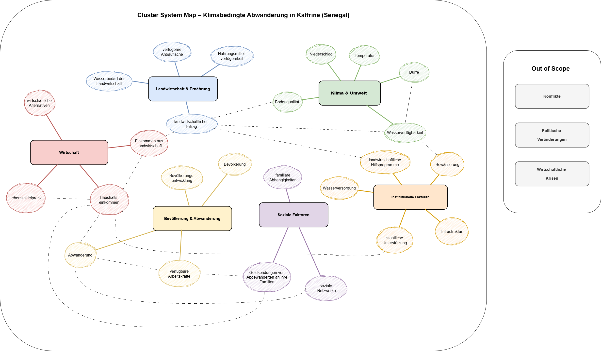
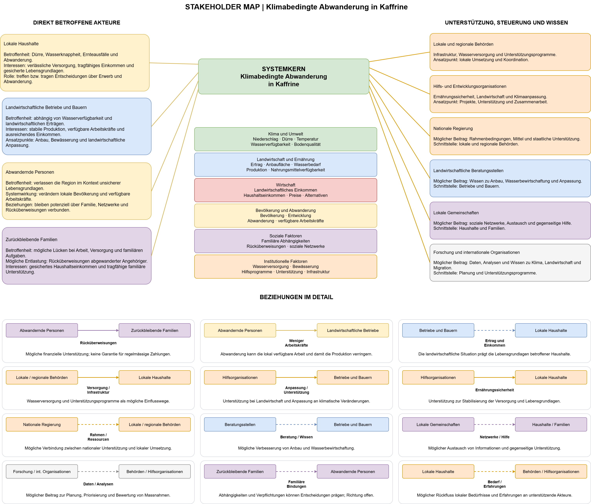
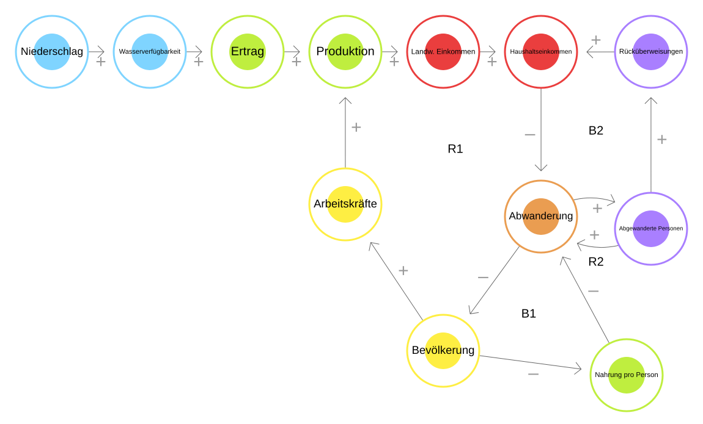
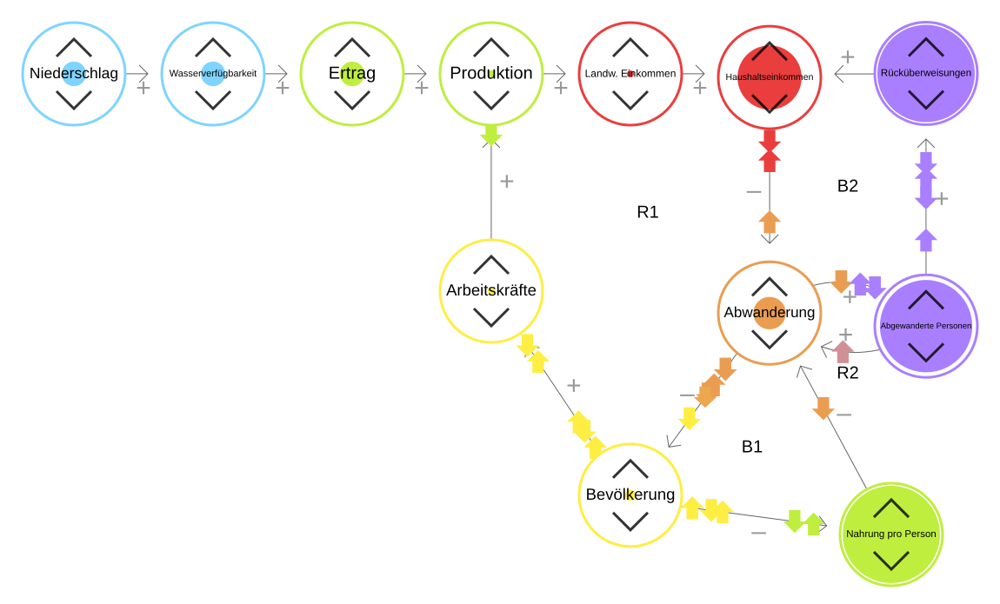

# **LE1 – Systemkarte: Klimabedingte Abwanderung aus Kaffrine**

## **1. Leitfrage**

> Wie wirken sich Dürren über Wasserverfügbarkeit, Ernte und Einkommen auf die Abwanderung aus der Region Kaffrine (Senegal) aus, und wie wirkt die Abwanderung auf Bevölkerung, Landwirtschaft und Versorgung in der Region zurück?

## **2. Systemgrenzen**

### **Ort**

Region Kaffrine im Senegal (Sahel-Zone) und die Menschen, die von dort dauerhaft wegziehen. Zuwanderung wird im Simulationsmodell (LE2) als einfacher Zufluss berücksichtigt. Nicht betrachtet werden Zielorte, Rückkehr, saisonale Migration, Konflikte, Politik und Wirtschaftskrisen.

### **Zeitraum**

| Zeitraum | Zweck |
|---|---|
| 2013–2023 | Modell mit echten Daten vergleichen (Backtest) |
| 2024–2050 | Szenarien für die Zukunft |

Der Zeitraum richtet sich nach den Daten, die wir gefunden haben:

| Grösse | Quelle | Was es gibt |
|---|---|---|
| Niederschlag | CHIRPS v2.0 (Satelliten- und Stationsdaten) | jährlich ab 1981 |
| Bevölkerung | ANSD (Statistikamt Senegal), Volkszählungen; Werte z.B. bei citypopulation.de | 2013, 2023 (Kaffrine 2013: 566 992, 2023: 820 405) |
| Abwanderung | ANSD, Volkszählung 2023, Kapitel Migration | nur Momentaufnahmen, z.B. 27 588 Wegzüge aus Kaffrine in den letzten 5 Jahren (innerhalb Senegals) |
| Landwirtschaft | ANSD, Situation Economique et Sociale Kaffrine (SES 2013 bis 2022–2023) | Erträge Hirse und Erdnuss 2009–2023, ohne 2014–2016 |

Die Region Kaffrine gibt es seit 2008; Volkszählungswerte liegen für 2013 und 2023 vor, Niederschlagsdaten lückenlos. Für die Abwanderung gibt es keine Zeitreihe; der Vergleich mit echten Daten läuft deshalb vor allem über die Bevölkerung.

## **3. Cluster System Map**

Die Cluster System Map sammelt alle Faktoren, die zu Beginn wichtig erschienen, und ordnet sie nach Themen.

### **Von der Cluster Map zur Causal Loop Map**

Alle Faktoren der Cluster Map stehen in Teil 02 der Causal Loop Map (Detailmodule). In Teil 01 (Kernmodell), das wir in LE2 simulieren, haben wir nur die wichtigsten übernommen:

| Faktor | Im Kernmodell? | Warum |
|---|---|---|
| Niederschlag | ja, von aussen vorgegeben | wichtigster Klimatreiber, gut messbar |
| Wasserverfügbarkeit, Ertrag, Produktion, Einkommen, Bevölkerung, Arbeitskräfte, Abwanderung | ja | Kern der Leitfrage |
| Nahrungsmittelverfügbarkeit pro Person | ja, als «Produktion pro Kopf» | zeigt die Versorgung der Region (Schleife B1), zusammen mit dem landwirtschaftlichen Einkommen |
| Soziale Netzwerke | ja, als «Abgewanderte Personen» | Netzwerke entstehen durch bereits Weggezogene, diese lassen sich zählen (Schleife R2) |
| Rücküberweisungen | ja | Schleife B2 |
| Dürre | nein | ist zu wenig Niederschlag, würde denselben Effekt doppelt zählen |
| Temperatur, Boden, Anbaufläche, Wasserbedarf | nein | wirken indirekt oder langsam, Anbaufläche als gleichbleibend angenommen |
| Lebensmittelpreise, Kaufkraft, wirtschaftliche Alternativen | nein | hängen von Märkten ausserhalb ab, als gleichbleibend angenommen |
| Familiäre Abhängigkeiten | nein | Wirkung unklar: können zum Bleiben oder zum Gehen führen |
| Behörden, Hilfsprogramme, Bewässerung | nein | mögliche Massnahmen, werden in LE4 als Szenarien getestet |

## **4. Stakeholder Map**

Unten in der Karte sind die Akteure nach Einfluss und Betroffenheit eingeordnet (neu gegenüber der ersten Version `previous_versions/stakeholder_map_v1.png`). Regierung, Behörden und Hilfsorganisationen können viel bewirken, tragen die Folgen aber kaum selbst. Sie sind die Ansprechpartner für die Massnahmen in LE4.

## **5. Causal Loop Map**

Teil 01 ist das Kernmodell, das wir in LE2 simulieren. Teil 02 zeigt alle Faktoren der Cluster Map. R = verstärkende Schleife, B = ausgleichende Schleife.

### **Änderungen gegenüber der ersten Version**

Teil 02 ist unverändert. Im Kernmodell haben wir gegenüber der ersten Version `previous_versions/causal_loop_map_v1.png` geändert:

| Änderung | Warum |
|---|---|
| Dürre entfernt, Niederschlag grau | Dürre und Niederschlag zählten denselben Effekt doppelt. |
| Ertrag → Produktion statt Ertrag → Einkommen | Der Ertrag pro Hektar wirkt über die gesamte Ernte auf das Einkommen. |
| Landw. Einkommen → Haushaltseinkommen statt landw. Einkommen → Abwanderung | Vorher zeigten zwei Einkommen direkt auf die Abwanderung. Das zählte das Einkommen doppelt. |
| Bevölkerung → Arbeitskräfte statt Abwanderung → Arbeitskräfte | Wer wegzieht, verringert zuerst die Bevölkerung, erst dadurch die Arbeitskräfte. |
| Neu: Abgewanderte Personen, Schleife R2 | Wer schon weg ist, hilft anderen beim Wegziehen. |
| Rücküberweisungen kommen von den Abgewanderten Personen (B2) | Geld schicken alle, die schon weg sind, nicht nur die, die dieses Jahr gehen. |
| Neu: Nahrungsmittelverfügbarkeit pro Person, Schleife B1 | zeigt die Rückwirkung der Abwanderung auf die Region |
| Verzögerungen (\|\|) markiert, Schleifen nummeriert | Vorbereitung für LE2 |

Nach der Umsetzung in LE2 wurde das Kernmodell ein zweites Mal angepasst (Vorgängerversion `previous_versions/causal_loop_map_v2.png`):

| Änderung | Warum |
|---|---|
| Landwirtschaftliches Einkommen und Nahrung pro Person zu «Produktion pro Kopf» zusammengefasst | Beide sind Produktion geteilt durch Bevölkerung. Als zwei Wege zur Abwanderung hätten sie die Versorgung doppelt gezählt. |
| B1 läuft über Produktion pro Kopf und Haushaltseinkommen pro Kopf | Weniger Menschen teilen sich dieselbe Produktion. Das wirkt über das Einkommen pro Kopf auf die Abwanderung. |
| Neu: Natürliches Wachstum, Schleife R3 | Das Bevölkerungswachstum ist in LE2 der stärkste Treiber und gehört deshalb in die Karte. |
| B2 nicht mehr als «möglich» markiert | Die Schleife ist in LE2 umgesetzt. |

### **Schleifen**

| Schleife | Art | Ablauf | Was passiert |
|---|---|---|---|
| R1 Arbeitskräfte–Einkommen | verstärkend (Vermutung) | Abwanderung → Bevölkerung (−) → Arbeitskräfte (+) → Produktion (+) → Produktion pro Kopf (+) → Haushaltseinkommen pro Kopf (+) → Abwanderung (−) | Wer wegzieht, fehlt als Arbeitskraft. Die Ernte sinkt, das Einkommen auch, und noch mehr Menschen ziehen weg. |
| R2 Netzwerk | verstärkend, verzögert | Abwanderung → Abgewanderte Personen (+) → Abwanderung (+) | Wer schon weg ist, erleichtert anderen das Wegziehen. |
| B1 Versorgung pro Kopf | ausgleichend | Abwanderung → Bevölkerung (−) → Produktion pro Kopf (−) → Haushaltseinkommen pro Kopf (+) → Abwanderung (−) | Weniger Menschen teilen sich dieselbe Ernte. Nahrung und Einkommen pro Kopf steigen, der Druck wegzuziehen sinkt. |
| B2 Rücküberweisungen | ausgleichend, verzögert | Abwanderung → Abgewanderte Personen (+) → Rücküberweisungen (+) → Haushaltseinkommen pro Kopf (+) → Abwanderung (−) | Geld von Abgewanderten hilft den Familien. Weniger Menschen müssen wegziehen. |
| R3 Natürliches Wachstum | verstärkend | Bevölkerung → Natürliches Wachstum (+) → Bevölkerung (+) | Eine grössere Bevölkerung hat mehr Geburten. Das Wachstum beschleunigt sich selbst. |

R1 und B1 beginnen beide bei der sinkenden Bevölkerung, wirken aber gegeneinander. Welche Schleife stärker ist, untersuchen wir in LE2. Dort zeigt sich, dass B1 überwiegt, solange die Bevölkerung wächst.

Die Wirkung des Haushaltseinkommens pro Kopf auf die Abwanderung ist verzögert (||). Die Ernte fällt im Herbst an, abgewandert wird in der folgenden Trockenzeit.

### **Exploration in Loopy**

Das Kernmodell ist in Loopy nachgebaut (Stand Version 2, also noch mit getrenntem Einkommen und Nahrung pro Person und ohne R3; die qualitativen Aussagen bleiben gültig). Darin sieht man, wie sich eine Veränderung durch die Schleifen ausbreitet.

**Modell**

**Experiment Dürre** (Niederschlag einmal gesenkt)

- Über Wasser, Ernte und Einkommen steigt die Abwanderung, und die Zahl der abgewanderten Personen wächst.
- Mit R2 steigt die Abwanderung deutlich stärker als ohne (Vergleich: Pfeil «Abgewanderte Personen → Abwanderung» entfernt).
- Danach schwanken die Werte, ohne zur Ruhe zu kommen. Welche Schleife langfristig überwiegt, kann Loopy nicht zeigen. Das untersuchen wir in LE2.

### **Grenzen der Karte**

**Einkommen und Abwanderung:** 
- Sehr arme Haushalte können sich das Wegziehen oft nicht leisten
- Mehr Einkommen kann deshalb zuerst sogar zu mehr Abwanderung führen. Das «−» zeigt den Normalfall

**R1 ist eine Vermutung:** 
- Im ländlichen Sahel gibt es oft mehr Arbeitskräfte als Arbeit
- Ob die Ernte sinkt, wenn Menschen wegziehen, ist unsicher

## **6. Systemische Einordnung**

### **Feedback**

Das System wird von drei verstärkenden (R1, R2, R3) und zwei ausgleichenden Schleifen (B1, B2) geprägt. Die verstärkenden Schleifen können eine einmalige Dürre über Jahre nachwirken lassen, die ausgleichenden begrenzen die Abwanderung.

### **Nichtlinearität**

- **Einkommen und Abwanderung:** Sehr arme Haushalte können sich das Wegziehen nicht leisten. Steigt das Einkommen von einem tiefen Niveau, kann die Abwanderung zuerst steigen und erst später sinken. Die Karte zeigt mit «−» nur den Normalfall.
- **Ertrag:** Unter einer Mindestmenge Regen fällt die Ernte ganz aus. Die Wirkung von Niederschlag auf den Ertrag ist deshalb nicht proportional.
- **Netzwerk:** Je mehr Menschen schon weg sind, desto leichter wird das Wegziehen. Das kann die Abwanderung beschleunigen, statt sie gleichmässig wachsen zu lassen.

### **Emergenz**

Niemand entscheidet über die Abwanderungsrate der Region. Sie entsteht aus vielen Entscheidungen einzelner Haushalte, die von Ernte, Einkommen und Kontakten zu bereits Abgewanderten abhängen. Muster wie Migrationsketten in dieselben Zielorte sind ein emergentes Ergebnis dieser Netzwerke.

### **Rebound**

- **Abwanderung:** Wer wegzieht, entlastet die Versorgung der Zurückbleibenden (B1). Ein Teil der Wirkung einer Dürre auf die Abwanderung wird so wieder aufgehoben.
- **Produktivität:** Steigt die Produktion, steigt das Einkommen pro Kopf nur, wenn die Bevölkerung nicht gleich schnell wächst. Bessere Erträge können zudem das Wegziehen erst finanzierbar machen.
- **Bewässerung:** Bewässerung stabilisiert die Ernte, kann aber die Anbaufläche und damit den Wasserbedarf erhöhen.

### **Wahl des Modellansatzes**

| Ansatz | Passt für | Grenzen für diese Fragestellung |
|---|---|---|
| Systemdynamik (LE2) | Bestände (Bevölkerung, Abgewanderte), Rückkopplungen und Verzögerungen auf Ebene der Region, passend zu den Volkszählungsdaten | keine Unterschiede zwischen Haushalten, keine Schwellenwerte einzelner Personen |
| Agentenbasiert (LE3) | arme und reiche Haushalte, individuelle Schwellenwerte, Netzwerke zwischen Familien | braucht Daten auf Haushaltsebene, die für Kaffrine fehlen |
| Szenario- und integrierte Modelle (LE4) | Klimaszenarien und Handlungsoptionen über mehrere Domänen | bildet die Rückkopplungen der Migration nur vereinfacht ab |

Wir wählen Systemdynamik für das Kernmodell, weil die Leitfrage nach der Region als Ganzes fragt, die Daten nur auf Ebene der Region vorliegen und die Rückkopplungen über Bestände laufen. LE4 baut auf diesem Modell auf und ergänzt Klimaszenarien und Handlungsoptionen.
