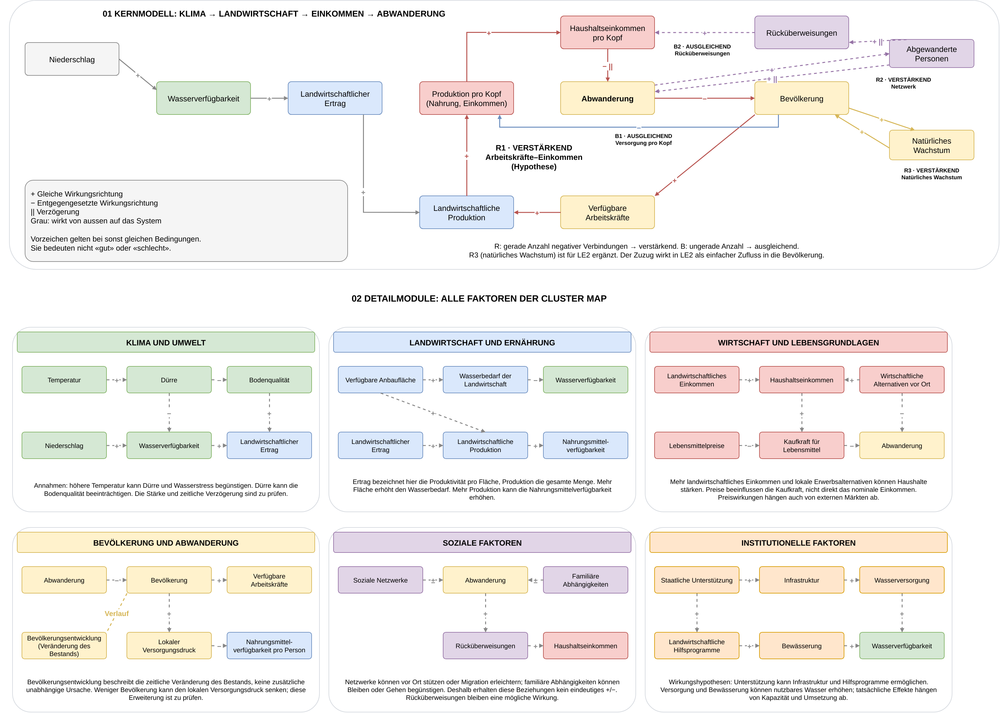

Lösungsskizze für LE4. Beschrieben wird, wie die Szenarioanalyse aufgebaut wäre und mit welchem Modell, welchen Parametern und welchen Daten sie gerechnet würde. Die Rechnung selbst wird nicht umgesetzt. Grundlage ist das System-Dynamics-Modell aus LE2 (`../LE2_system_dynamics/model.py`).

```{python}
import matplotlib.pyplot as plt
```

## **1 Problemstellung und Kenngrössen**

Die Szenariofragen ergeben sich aus LE1 und LE2. LE2 zeigt, dass Dürren die Abwanderung erhöhen, die Bevölkerungsdynamik aber stärker wirkt. Die Ertragsdaten in LE2 zeigen zudem eine steigende Produktivität, die im LE2-Modell fehlt.

- **F1:** Wie stark erhöhen wiederkehrende Dürren und ein trockeneres Klima die Abwanderung aus Kaffrine bis 2050?
- **F2:** Wie viel dieser Zusatzabwanderung liesse sich mit einer Anpassung der Landwirtschaft vermeiden, also mit stabileren Erträgen (Bewässerung, dürretolerante Sorten) oder mit steigender Produktivität?
- **F3:** Welcher Kanal prägt die Abwanderung stärker, das Klima oder die Entwicklung von Produktivität und Bevölkerung?

| Kenngrösse | Einheit | Bedeutung |
|---|---|---|
| Kumulierte Abwanderung 2024–2050 | Personen | Gesamtwirkung eines Szenarios |
| Klimabedingte Zusatzabwanderung | Personen | Differenz zum Klimaszenario basis bei gleicher Handlungsoption |
| Ertragsindex | – | Übertragung des Niederschlags auf die Landwirtschaft |
| Nahrung pro Person 2050 | Index | Versorgung der Zurückbleibenden |

Szenarien sind nötig, weil der künftige Niederschlag unsicher ist und Handlungsoptionen verglichen werden sollen. Sie sind keine Prognosen.

## **2 Systemgrenzen**

Die Systemgrenzen entsprechen dem Kernmodell der Systemkarte aus LE1.



| Bereich | Umgang |
|---|---|
| Niederschlag | von aussen vorgegeben, ab 2024 als Szenario |
| Ertrag, Produktion, Einkommen, Nahrung | im Modell berechnet (Index) |
| Bevölkerung, Abwanderung, Abgewanderte | im Modell berechnet (Stocks und Flows) |
| Zuzug | konstante Rate aus der Volkszählung |
| Handlungsoptionen | über Parameter des Ertrags (Abschnitt 7) |
| Zielorte, Preise, Politik, Konflikte | ausserhalb des Systems |

## **3 Übertragungskanäle**

Der Hauptkanal führt vom Klima über die Landwirtschaft zur Abwanderung. Die Zyklen aus LE1 werden an den beiden Beständen aufgebrochen. Innerhalb eines Zeitschritts gelten Bevölkerung und Abgewanderte als gegeben; ihre Rückwirkung (R1, B1 über die Bevölkerung, R2, B2 über die Abgewanderten) wirkt erst im nächsten Jahr. Zusätzlich wirkt der Abwanderungsdruck mit einem Jahr Verzögerung.

```{python}
knoten = {
    "Niederschlag\n(Szenario)": (0.0, 3.0), "Wasser-\nverfügbarkeit": (1.7, 3.0), "Ertrag": (3.4, 3.0),
    "Produktion": (5.1, 3.0), "Nahrung und\nEinkommen pro Kopf": (6.8, 3.0),
    "Abwanderungs-\ndruck (verzögert)": (8.5, 3.0), "Abwanderung": (10.2, 3.0),
    "Bevölkerung": (10.2, 1.0), "Abgewanderte": (10.2, 5.0), "Rücküberweisungen": (6.8, 5.0),
    "Stabile Erträge\n(Option)": (3.4, 5.0), "Produktivität\n(Option)": (3.4, 1.0),
}
farbe = {"Niederschlag\n(Szenario)": "#d9d9d9", "Stabile Erträge\n(Option)": "#d5e8d4", "Produktivität\n(Option)": "#d5e8d4",
         "Bevölkerung": "#fff2cc", "Abgewanderte": "#fff2cc"}
haupt = [("Niederschlag\n(Szenario)", "Wasser-\nverfügbarkeit"), ("Wasser-\nverfügbarkeit", "Ertrag"), ("Ertrag", "Produktion"),
         ("Produktion", "Nahrung und\nEinkommen pro Kopf"), ("Nahrung und\nEinkommen pro Kopf", "Abwanderungs-\ndruck (verzögert)"),
         ("Abwanderungs-\ndruck (verzögert)", "Abwanderung")]
rueck = [("Abwanderung", "Bevölkerung"), ("Bevölkerung", "Produktion"), ("Bevölkerung", "Nahrung und\nEinkommen pro Kopf"),
         ("Abwanderung", "Abgewanderte"), ("Abgewanderte", "Rücküberweisungen"),
         ("Rücküberweisungen", "Nahrung und\nEinkommen pro Kopf"), ("Abgewanderte", "Abwanderungs-\ndruck (verzögert)")]
option = [("Stabile Erträge\n(Option)", "Ertrag"), ("Produktivität\n(Option)", "Ertrag")]

fig, ax = plt.subplots(figsize=(13, 5.5))
for liste, stil, col in [(haupt, "-", "#1f4e79"), (rueck, "--", "#c55a11"), (option, "-", "#38761d")]:
    for a, b in liste:
        ax.annotate("", xy=knoten[b], xytext=knoten[a],
                    arrowprops=dict(arrowstyle="-|>", color=col, lw=1.6, ls=stil, shrinkA=38, shrinkB=38,
                                    connectionstyle="arc3,rad=0.08" if stil == "--" else "arc3"))
for name, (x, y) in knoten.items():
    ax.text(x, y, name, ha="center", va="center", fontsize=9,
            bbox=dict(boxstyle="round,pad=0.5", fc=farbe.get(name, "#dae8fc"), ec="#555555"))
ax.plot([], [], color="#1f4e79", label="Hauptkanal")
ax.plot([], [], color="#c55a11", ls="--", label="Rückkanal, wirkt im nächsten Zeitschritt")
ax.plot([], [], color="#38761d", label="Handlungsoption")
ax.legend(loc="lower left", fontsize=9, frameon=False)
ax.set(xlim=(-0.8, 11.0), ylim=(0.2, 5.8), title="Übertragungskanäle (Zyklen an den Beständen aufgebrochen)")
ax.axis("off")
plt.show()
```

## **4 Raum- und Zeitskalen**

- **Raum:** Region Kaffrine als Ganzes, ohne räumliche Auflösung. Migrations- und Bevölkerungsdaten liegen nur regional vor; der Niederschlag (CHIRPS, 0.05°) wird über die Region gemittelt.
- **Zeit:** Zeitschritt 1 Jahr, entsprechend einer Regenzeit pro Jahr. Kalibrierung mit Daten bis 2023, Szenarien 2024–2050.
- **Aktivierung:** Der Niederschlag eines Jahres bestimmt die Ernte im Herbst, die Abwanderung reagiert in der folgenden Trockenzeit.

## **5 Module**

| Modul | Rolle | Nachparametrisierung |
|---|---|---|
| SD-Modell LE2 (`model.py`) | Kanal Ertrag → Einkommen und Nahrung → Abwanderung → Bevölkerung | keine; für die Option Produktivität käme ein Parameter für das Ertragswachstum ab 2024 hinzu |
| Ertragsbeziehung (LE2, Abschnitt 3) | Kanal Niederschlag → Ertrag | bereits aus ANSD-Erträgen und CHIRPS geschätzt (`elast_ertrag` = 0.7) |
| CLIMADA | möglicher Ausbau: Dürre als Hazard, Anbaufläche als Exposure, Ertragsverlust als Impact-Funktion | siehe `02_climada.qmd` |

## **6 Kennzahlen und Funktionsparameter**

Zuerst die Schätzung vor der Datenanalyse, dann der Vergleich mit den Daten, soweit sie in LE2 schon ausgewertet sind.

| Grösse | Schätzung vorab | Daten (LE2) | Kommentar |
|---|---|---|---|
| Elastizität des Ertrags auf den Niederschlag | 1.0 (Regenfeldbau) | Hirse 0.46, Erdnuss 0.94 | Modell verwendet das gerundete Mittel 0.7 |
| Trend des Ertrags | 0 | Hirse +5.1 %, Erdnuss +2.2 % pro Jahr | kurze, lückenhafte Reihen |
| Basis-Abwanderungsrate | 0.74 % pro Jahr | Volkszählung 2023, Fünfjahresfenster | Einjahresfenster ergibt 3.2 % (zirkuläre Migration, nicht modelliert) |
| Zuzugsrate | 0.36 % pro Jahr | Volkszählung 2023 | konstant |
| Natürliches Wachstum | 3.36 % pro Jahr | Geburten- minus Sterberate 2023 | konstant |
| Wirkung stabiler Erträge | Elastizität halbiert | keine | Annahme für die Handlungsoption |
| Produktivitätswachstum | 2 % pro Jahr ab 2024 | untere Grenze der beobachteten Trends | Annahme für die Handlungsoption |

## **7 Ausgangszustand und Szenarien**

- **Ausgangszustand:** Volkszählung 2013 und Zustand des LE2-Modells. Von 2013 bis 2023 läuft das Modell mit dem gemessenen Niederschlag, die Szenarien beginnen 2024.
- **Klimaszenarien:** Für den westlichen Sahel, zu dem Senegal gehört, projizieren CMIP6-Modelle unter SSP5-8.5 eine Abnahme des Niederschlags, im Gegensatz zum zentralen und östlichen Sahel (Wane et al. 2025, Science Advances 11, eadu5415). Eine Grössenordnung für Kaffrine nennt die Studie nicht. Die Richtung der Szenarien ist damit belegt, ihre Stärke ist eine Annahme.
- **Handlungsoptionen:** Stabilere Erträge stehen für Bewässerung oder dürretolerante Sorten und halbieren die Reaktion des Ertrags auf den Niederschlag. Produktivität steht für bessere Inputs und Anbaumethoden und lässt den Ertrag ab 2024 um 2 % pro Jahr wachsen.

| Klimaszenario | Niederschlag ab 2024 |
|---|---|
| basis | jedes Jahr Mittel 1991–2020 |
| duerren | alle 5 Jahre 30 % weniger Niederschlag |
| trockener | dauerhaft 15 % weniger Niederschlag |

| Handlungsoption | Umsetzung im Modell |
|---|---|
| keine | wie LE2 |
| stabile Erträge | `elast_ertrag` halbiert (0.35) |
| Produktivität | Ertrag ab 2024 mit 2 % pro Jahr multipliziert |
| beides | beide Änderungen |

Daraus ergeben sich 3 × 4 = 12 Läufe des LE2-Modells.

## **8 Geplante Ergebnisse**

**Darstellung**

- Tabelle der kumulierten Abwanderung 2024–2050 für alle 12 Kombinationen
- Tabelle und Balkendiagramm der klimabedingten Zusatzabwanderung je Handlungsoption
- Zeitverlauf von Abwanderung und Nahrung pro Person im Szenario trockener

**Erwartete Ergebnisse (Hypothesen)**

- **H1 zu F1:** Ohne Anpassung liegt die Zusatzabwanderung in der Grössenordnung der LE2-Szenarien, also rund 21 000 (Dürren) bis 45 000 Personen bis 2050.
- **H2 zu F2:** Stabile Erträge verringern die Zusatzabwanderung etwa im Verhältnis der Elastizität, eine halbierte Elastizität also etwa um die Hälfte. Produktivitätswachstum senkt die gesamte Abwanderung, verringert den Klimaeffekt aber kaum, weil ein höherer Ertrag bei gleicher prozentualer Einbusse absolut mehr verliert.
- **H3 zu F3:** Die Versorgung pro Kopf, also das Verhältnis von Produktivität und Bevölkerung, prägt die Abwanderung stärker als der Niederschlag. Das legen die Sensitivitätsanalyse und der Basislauf in LE2 nahe.

## **9 Backtest (Beschreibung)**

- **Kanal Niederschlag → Ertrag:** Die beobachteten Erträge 2009–2023 um den Trend bereinigen und mit dem Ertragsindex des Modells vergleichen (Korrelation, mittlere Abweichung). Ausserhalb der Stichprobe hiesse das, Elastizität und Trend nur mit 2009–2018 zu schätzen und 2019–2023 vorherzusagen.
- **Abwanderung:** Simulation 2013–2023 mit der Volkszählung 2023 vergleichen. In LE2 durchgeführt; die Bevölkerung 2023 wird um rund 8 % unterschätzt, die Wegzüge sind eine Konsistenzprüfung, weil die Rate aus denselben Daten stammt.
- **Dürre 2014:** Prüfen, ob die Abwanderung 2015 messbar anstieg. Dafür fehlt eine jährliche Migrationsreihe; möglich wären Erhebungen zu Ernährungssicherheit oder Daten der IOM.

## **10 Erwartete Erkenntnisse und Limitationen**

**Erwartete Erkenntnisse**

- Dürren verstärken die Abwanderung, erklären aber nur einen kleinen Teil davon.
- Massnahmen, die Erträge stabilisieren, zielen direkt auf den Klimaeffekt.
- Ob die Landwirtschaft mit dem Bevölkerungswachstum Schritt hält, entscheidet stärker über die Abwanderung als der Niederschlag.

**Limitationen**

- Szenarien sind Was-wäre-wenn-Rechnungen. Die Richtung der Klimaszenarien ist belegt, die Stärke nicht.
- Die Wirkung der Handlungsoptionen ist angenommen, nicht gemessen.
- Ein einziger Ertragsindex für Nahrung und Einkommen; Hirse und Erdnuss reagieren unterschiedlich.
- Nur dauerhafte Abwanderung; saisonale Migration als häufige Reaktion auf Dürren fehlt.

**Weiterführende Fragen**

- Wie ändern sich die Ergebnisse, wenn Hirse (Nahrung) und Erdnuss (Einkommen) getrennt modelliert werden?
- Bis zu welcher Stärke der Austrocknung kann Produktivitätswachstum die Versorgung pro Kopf halten?
