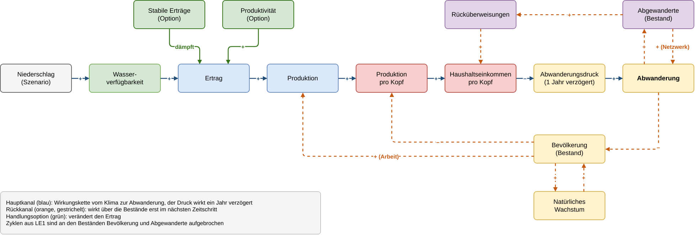

# **4) Übertragungskanäle und Szenarien – Lösungsskizze**

Lösungsskizze für LE4. Beschrieben werden Lösungsstrategie, Auswertungsstrategie und Datenquellen einer Szenarioanalyse zur Abwanderung aus Kaffrine bis **2050**. Gerechnet wird in LE4 nicht. Alle Zahlen stammen aus dem Systemdynamik-Modell in `../LE2_system_dynamics/01_model.ipynb`.

## **4.1) Problemstellung und Kenngrössen**

LE2 zeigt, dass Dürren die Abwanderung erhöhen, das Verhältnis von Produktivität und Bevölkerung aber stärker wirkt. Die Szenarioanalyse fragt deshalb, wie Klima und Handlungsoptionen zusammenwirken.

- **F1:** Wie stark erhöhen wiederkehrende Dürren und ein trockeneres Klima die Abwanderung aus Kaffrine bis **2050**?
- **F2:** Wie viel dieser Zusatzabwanderung liesse sich mit stabileren Erträgen (Bewässerung, dürretolerante Sorten) oder mit steigender Produktivität vermeiden?
- **F3:** Welcher Kanal prägt die Abwanderung stärker, das Klima oder die Entwicklung von Produktivität und Bevölkerung?

| Kenngrösse | Einheit | Bedeutung |
|---|---|---|
| Kumulierte Abwanderung **2024** bis **2050** | Personen | Gesamtwirkung einer Kombination aus Klimaszenario und Handlungsoption |
| Klimabedingte Zusatzabwanderung | Personen | Differenz zum Klimaszenario `basis` bei gleicher Handlungsoption |
| Ertragsindex | Index | Übertragung des Niederschlags auf die Landwirtschaft |
| Nahrung pro Person **2050** | Index | Versorgung der Zurückbleibenden |

Szenarien sind nötig, weil der künftige Niederschlag unsicher ist und Handlungsoptionen verglichen werden sollen. Sie sind keine Prognosen, sondern konsistente Was-wäre-wenn-Annahmen.

## **4.2) Systemgrenzen**

Die Systemgrenzen entsprechen dem Kernmodell der Systemkarte aus LE1 (`../LE1_system_mapping/01_system_map.md`).

- **Von aussen vorgegeben:** Niederschlag als Klimaszenario, Produktivität ab **2024** als Handlungsoption
- **Im Modell berechnet:** Ertrag, Produktion, Einkommen und Nahrung pro Kopf, Bevölkerung, Abwanderung, Abgewanderte, Rücküberweisungen
- **Handlungsoptionen:** wirken über die Parameter des Ertrags
- **Ausserhalb:** Zielorte, Preise, Politik, Konflikte, saisonale Migration

## **4.3) Übertragungskanäle**

Der Hauptkanal führt vom Klima über die Landwirtschaft und das Einkommen pro Kopf zur Abwanderung. Die Zyklen aus LE1 werden an den beiden Beständen aufgebrochen. Innerhalb eines Zeitschritts gelten Bevölkerung und Abgewanderte als gegeben, ihre Rückwirkung über R1, B1, R2, B2 und R3 wirkt erst im nächsten Jahr.

- **Hauptkanal:** Niederschlag → Wasserverfügbarkeit → Ertrag → Produktion → Produktion pro Kopf → Haushaltseinkommen pro Kopf → Abwanderungsdruck → Abwanderung
- **Rückkanäle:** über die Bevölkerung (Arbeitskräfte, Verteilung auf mehr oder weniger Köpfe, natürliches Wachstum) und über die Abgewanderten (Netzwerk, Rücküberweisungen)
- **Ansatzpunkte der Handlungsoptionen:** beide am Ertrag, also möglichst früh im Hauptkanal

## **4.4) Raum- und Zeitskalen**

- **Raum:** Region Kaffrine als Ganzes, ohne räumliche Auflösung. Migrations- und Bevölkerungsdaten liegen nur regional vor, der Niederschlag (CHIRPS, 0.05°) wird über die Region gemittelt
- **Zeit:** Zeitschritt 1 Jahr, entsprechend einer Regenzeit und einer Ernte pro Jahr. Kalibrierung bis **2023**, Szenarien **2024** bis **2050**
- **Aktivierung:** Der Niederschlag eines Jahres bestimmt die Ernte im Herbst, die Abwanderung reagiert in der folgenden Trockenzeit

## **4.5) Kennzahlen und Funktionsparameter**

Gemäss Aufgabenstellung werden die Werte zuerst abgeschätzt und dann mit den Daten aus LE2 verglichen.

| Grösse | Schätzung vorab | Daten (LE2) | Art | Kommentar |
|---|---|---|---|---|
| Elastizität des Ertrags auf den Niederschlag | 1.0 (Regenfeldbau) | Hirse 0.46, Erdnuss 0.94 | geschätzt | Modell verwendet das gerundete Mittel 0.7 |
| Trend des Ertrags bis **2023** | 0 | Hirse **+5.1 %**, Erdnuss **+2.2 %** pro Jahr | geschätzt | Modell verwendet **3.5 %** |
| Basis-Abwanderungsrate | **0.74 %** pro Jahr | **0.94 %** pro Jahr | kalibriert | trifft die **27'588** Wegzüge **2018** bis **2023** |
| Zuzugsrate | **0.36 %** pro Jahr | **0.36 %** pro Jahr | geschätzt | konstant |
| Natürliches Wachstum | **3.36 %** pro Jahr | **3.36 %** (**2023**) bis **3.79 %** (**2013**) | geschätzt | bis **2023** linear zwischen beiden Werten, danach konstant |
| Wirkung stabiler Erträge | Elastizität halbiert | keine | Annahme | Handlungsoption |
| Produktivitätswachstum ab **2024** | **2 %** pro Jahr | untere Grenze der beobachteten Trends | Annahme | Handlungsoption |

**Geschätzte und kalibrierte Parameter.** Geschätzte Parameter werden direkt aus Daten berechnet, unabhängig vom Modell, zum Beispiel die Elastizität aus der Regression der Erträge. Kalibrierte Parameter werden so eingestellt, dass das Modell einen beobachteten Wert trifft, zum Beispiel die Basis-Abwanderungsrate. Ein kalibrierter Wert ist nur innerhalb der Modellstruktur sinnvoll und kann nicht gleichzeitig zur Validierung dieses Werts dienen.

## **4.6) Ausgangszustand und Szenarien**

- **Ausgangszustand:** Volkszählung **2013** und Zustand des LE2-Modells. Von **2013** bis **2023** läuft das Modell mit dem gemessenen Niederschlag und dem beobachteten Produktivitätstrend
- **Klimaszenarien:** Für den westlichen Sahel, zu dem Senegal gehört, projizieren CMIP6-Modelle unter SSP5-8.5 eine Abnahme des Niederschlags, im Gegensatz zum zentralen und östlichen Sahel. Eine Grössenordnung für Kaffrine liegt nicht vor. Die Richtung der Szenarien ist damit belegt, ihre Stärke ist eine Annahme
- **Handlungsoptionen:** Stabilere Erträge stehen für Bewässerung oder dürretolerante Sorten und halbieren die Reaktion des Ertrags auf den Niederschlag. Produktivität steht für bessere Inputs und Anbaumethoden und lässt den Ertrag ab **2024** um **2 %** pro Jahr wachsen

| Klimaszenario | Niederschlag ab **2024** |
|---|---|
| `basis` | jedes Jahr Mittel **1991** bis **2020** |
| `duerren` | alle 5 Jahre **30 %** weniger Niederschlag |
| `trockener` | dauerhaft **15 %** weniger Niederschlag |

| Handlungsoption | Umsetzung im Modell |
|---|---|
| keine | wie LE2 |
| stabile Erträge | `elast_ertrag` = 0.35 |
| Produktivität | `ertrag_trend_zukunft` = 0.02 |
| beides | beide Änderungen |

Daraus ergeben sich 3 × 4 = **12** Läufe.

## **4.7) Lösungsstrategie**

1. **Modell übernehmen:** Das LE2-Notebook mit `%run ../LE2_system_dynamics/01_model.ipynb` ausführen, damit LE2 und LE4 dieselben Funktionen (`simuliere`, `with_overrides`, `niederschlag_szenario`) und Parameter verwenden
2. **Szenarien definieren:** die drei Niederschlagsreihen mit `niederschlag_szenario` erzeugen
3. **Handlungsoptionen definieren:** die vier Parametersätze mit `with_overrides` erzeugen
4. **Läufe rechnen:** alle **12** Kombinationen simulieren und Jahreswerte speichern
5. **Kennzahlen berechnen:** kumulierte Abwanderung, klimabedingte Zusatzabwanderung je Handlungsoption, Nahrung pro Person **2050**
6. **Robustheit prüfen:** die Läufe mit den Bandbreiten der einflussreichsten Parameter aus LE2 wiederholen (`wirkung_netzwerk`, natürliches Wachstum, Basis-Abwanderungsrate)
7. **Backtest:** gemäss Abschnitt `4.9) Backtest`

## **4.8) Auswertungsstrategie**

**Darstellung**
- Tabelle der kumulierten Abwanderung **2024** bis **2050** für alle **12** Kombinationen
- Balkendiagramm der klimabedingten Zusatzabwanderung je Handlungsoption
- Zeitverlauf von Abwanderung und Nahrung pro Person im Szenario `trockener` für alle Handlungsoptionen

**Bewertung**
- **F1:** Zusatzabwanderung der Szenarien `duerren` und `trockener` ohne Handlungsoption
- **F2:** Anteil der Zusatzabwanderung, den eine Handlungsoption vermeidet
- **F3:** Vergleich der Wirkung der Produktivität mit der Wirkung des Klimas auf die gesamte Abwanderung
- **Robustheit:** Eine Aussage gilt nur, wenn die Rangfolge der Handlungsoptionen über alle Bandbreiten gleich bleibt

**Erwartete Ergebnisse (Hypothesen)**
- **H1 zu F1:** Ohne Anpassung liegt die Zusatzabwanderung bei rund **9'300** (Dürren) bis **20'500** Personen (trockeneres Klima). Das sind die Werte aus LE2
- **H2 zu F2:** Stabile Erträge verringern die Zusatzabwanderung etwa im Verhältnis der Elastizität, also etwa um die Hälfte. Produktivitätswachstum senkt die gesamte Abwanderung stark, verringert den Klimaeffekt aber nicht. LE2 zeigt bei **2 %** Produktivitätswachstum bereits **−23.4 %** gesamte Abwanderung im Szenario `basis`, aber einen leicht höheren Klimaeffekt der Dürren (**11'661** statt **9'315** Personen), weil ein höherer Ertrag bei gleicher prozentualer Einbusse absolut mehr verliert
- **H3 zu F3:** Das Verhältnis von Produktivität und Bevölkerung prägt die Abwanderung stärker als der Niederschlag

## **4.9) Backtest**

- **Kanal Niederschlag → Ertrag:** in LE2 durchgeführt. Mit einer Schätzung bis **2018** und Vorhersage **2019** bis **2023** verbessert der Niederschlag die Vorhersage für Hirse, nicht aber für Erdnuss. Für LE4 würde dieser Test mit einer längeren Ertragsreihe wiederholt
- **Bevölkerung:** in LE2 durchgeführt. Die Bevölkerung **2023** wird um **6.2 %** unterschätzt
- **Dürre 2014:** Prüfen, ob die Abwanderung **2015** messbar anstieg. Dafür fehlt eine jährliche Migrationsreihe. Möglich wären Erhebungen zur Ernährungssicherheit oder Daten der IOM
- **Handlungsoptionen:** Regionen oder Jahre mit Bewässerungsprojekten mit vergleichbaren Regionen ohne solche Projekte vergleichen, um die angenommene Halbierung der Elastizität zu prüfen

## **4.10) Datenquellen**

| Datenquelle | Inhalt | Status |
|---|---|---|
| CHIRPS v2.0 | Niederschlag **1991** bis **2023** | in LE2 verwendet |
| ANSD, RGPH-4 und RGPH-5 | Bevölkerung **2013** und **2023**, Migration aus beiden Volkszählungen | in LE2 verwendet |
| ANSD, Situation Economique et Sociale Kaffrine | Erträge Hirse und Erdnuss **2009** bis **2023** | in LE2 verwendet |
| ANSD, Projections démographiques 2023–2073 | Bevölkerungsprojektion als externer Vergleich | in LE2 verwendet |
| Wane et al. 2025, Science Advances 11, eadu5415 | Richtung der CMIP6-Niederschlagsprojektionen im westlichen Sahel | Grundlage der Klimaszenarien |
| CMIP6-Projektionen, z. B. über den Copernicus Climate Data Store | Niederschlag je SSP für die Region | geplant, um die Stärke der Szenarien zu begründen, Verfügbarkeit nicht geprüft |
| IOM, Flow Monitoring | jährliche Migrationsbewegungen | geplant für den Backtest der Dürre **2014**, Verfügbarkeit für Kaffrine nicht geprüft |

## **4.11) Möglicher Ausbau mit CLIMADA**

CLIMADA könnte den Kanal Niederschlag → Ertrag räumlich auflösen. Für die Abwanderung bleibt das SD-Modell nötig, weil CLIMADA keine Migrationsreaktion abbildet.

| Baustein | Mögliche Abbildung für Kaffrine |
|---|---|
| Hazard | Dürre bzw. Niederschlagsdefizit je Jahr und Rasterzelle, aus CHIRPS oder Klimaszenarien |
| Exposure | Anbaufläche von Hirse und Erdnuss je Département (ANSD, SES Kaffrine) |
| Vulnerability | Impact-Funktion Ertragsverlust in Abhängigkeit des Niederschlagsdefizits, kalibriert mit der Elastizität aus LE2 |
| Impact | Produktionsverlust je Jahr, als Eingang für den Ertragsindex des SD-Modells |

Der Mehrwert gegenüber der Regression wäre die räumliche Auflösung nach Départements und die Verwendung von Klimaszenarien als Hazard-Sets. Ob passende Hazard- und Exposure-Daten für Senegal über die CLIMADA Data API verfügbar sind, wurde nicht geprüft.

## **4.12) Erwartete Erkenntnisse und Limitationen**

**Erwartete Erkenntnisse**
- Dürren verstärken die Abwanderung, erklären aber nur einen kleinen Teil davon
- Massnahmen, die Erträge stabilisieren, zielen direkt auf den Klimaeffekt
- Ob die Landwirtschaft mit dem Bevölkerungswachstum Schritt hält, entscheidet stärker über die Abwanderung als der Niederschlag

**Limitationen**
- Szenarien sind Was-wäre-wenn-Rechnungen. Die Richtung der Klimaszenarien ist belegt, die Stärke nicht
- Die Wirkung der Handlungsoptionen ist angenommen, nicht gemessen
- Ein einziger Ertragsindex für Nahrung und Einkommen, obwohl Hirse und Erdnuss unterschiedlich reagieren
- Nur dauerhafte Abwanderung. Saisonale Migration, eine häufige Reaktion auf Dürren, fehlt
- Die einflussreichste Annahme (Netzwerkwirkung) ist nicht durch Daten gestützt

**Weiterführende Fragen**
- Wie ändern sich die Ergebnisse, wenn Hirse (Nahrung) und Erdnuss (Einkommen) getrennt modelliert werden?
- Bis zu welcher Stärke der Austrocknung kann Produktivitätswachstum die Versorgung pro Kopf halten?
